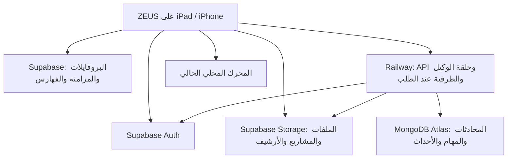

# خطة إصدار ZEUS السحابي وحساب المستخدم

تاريخ المراجعة: 26 أكتوبر 2026. مرجع الشفرة: `e3cc7251c22e80be8ac9fd3b39a14b286f75becd`.

هذه خطة تنفيذ وقبول للإصدار، وليست إعلانًا عن اكتمال المزايا أو نشر خادم عامل. الميزانية المعتمدة: الحصة المتبقية فقط، وقد حددها المالك بـ2.5 دولار مشتركة مع الخدمات الحالية، دون زيادة الفاتورة. لا ترقية آلية للخطط أو الموارد، ولا متصفح على Railway.

## 1. النتيجة المطلوبة

- حساب ZEUS واحد عبر Supabase Auth، بالبريد وكلمة المرور أو Google، يملك جميع بروفايلاته الدائمة وبياناتها وبيانات الوكيل.
- عرض تسجيل الدخول عند أول استعمال، ثم الاحتفاظ بالجلسة؛ لا يطلب الدخول في كل تشغيل. يظل استعمال البيانات المحلية ممكنًا للحساب المعروف عند انقطاع الشبكة.
- قسم «مكان تشغيل الوكيل» في إعدادات الوكيل: محلي أو سحابي. المحلي يحتفظ بالتنفيذ الحالي؛ السحابي ينقل حلقة الوكيل والطرفية والمهام والملفات إلى الخادم.
- قسم «الحساب والمزامنة» في إعدادات البروفايل الرئيسي، مستقل عن مكان تشغيل الوكيل. يمكن تشغيل الوكيل محليًا مع نسخ بياناته للحساب.
- الانتقال إلى السحابة يرفع البيانات اللازمة ويتحقق منها قبل تحرير المساحة المحلية. العودة للمحلي تعيد تحميل المطلوب بعد فحص المساحة.
- حذف التطبيق لا يرسل طلب حذف الحساب أو بيانات السحابة. بعد إعادة التثبيت والدخول تستعاد البيانات التي اكتمل حفظها، وتحمل الملفات الكبيرة عند طلبها.
- المتصفح نفسه وWebKit وعرض المحادثة يظلون على الجهاز. لا Chromium أو Playwright أو متصفح أتمتة على Railway.

## 2. ما تؤكده الشفرة الحالية

| الجزء | المصدر الحالي | ما يتطلبه الإصدار |
| --- | --- | --- |
| البروفايلات الدائمة وفهرسها | `ZEUSNext/BrowserData.swift`: `BrowserProfile`, `ProfileStore`, `ProfileData` | ربط الفهرس بمالك سحابي، وحفظ المعرّفات الثابتة عند الاستعادة |
| بيانات المتصفح | `ProfileData`: المواقع والسجل والسكربتات والتبويبات والمجموعات والنماذج والإعدادات ومواضع التمرير | جرد شامل لكل نوع؛ عدم الاكتفاء بتصدير الإعدادات |
| بيانات المواقع | `ProfileStore.websiteDataStore` يعزل `WKWebsiteDataStore` حسب UUID | الحفاظ على العزل، وتحديد ما تدعمه واجهات Apple للتصدير |
| التنزيلات وصور الحساب | `BrowserDisk.downloadsRoot` و`Accounts/<profileID>` | رفع الملفات الدائمة وصورها وفهرسها، دون إعادة تنزيلها كلها افتراضيًا |
| قيم النماذج وأسرار المزودين | `FormVault`, `AccountVault`, `AISecretVault` وKeychain الأصلية للوكيل | مسار صريح ومشفّر للأسرار؛ نسخ JSON وحده لا يحفظها |
| النسخ الحالية | `ZEUSNext/ProfileTransfer.swift`: `ProfileBackup` | التصدير الحالي ليس نسخة شاملة للحساب أو الوكيل، ويتطلب حدودًا تختلف عن المزامنة المستمرة |
| الوكيل | `ChatStore.shared`، ومسارات `Library/MinisChat/minis/<sessionID>` | الوكيل مشترك بين بروفايلات المتصفح حاليًا؛ يربط بمالك الحساب مرة واحدة، مع إبقاء سياق البروفايل للأدوات |
| مزامنة الوكيل الموجودة | `SyncCore`, `SyncTransport`, `PortableRecord`, `ICloudBackupManager` | الاستفادة من السجلات المحمولة والجرد الموجود، ومنع تعارض ناقلين يكتبان البيانات نفسها |
| الطرفية المحلية | `AIChatViewModel+ISHCommand.swift`, `ISHExecutionCoordinator` | تبقى للمحلي. السحابة تستعمل Linux وPTY فعليين، ولا تشغل iSH على iPad |
| خدمة المشاريع الموجودة | `Runtime/agent_service` | بها عامل ومهام وأحداث وموافقات وCodex، لكنها لمالك واحد وتخزن SQLite والمشاريع في `/data`؛ ليست الخادم المطلوب جاهزًا |
| متصفح الخدمة القديمة | `Runtime/Dockerfile`, `plugins.py`, `worker.py` | توجد Chromium وPlaywright وإضافة متصفح. يجب استبعادها من صورة ZEUS السحابية الجديدة ومن القدرات والتعليمات والاختبارات |
| ربط المجلدات الخارجية | إعدادات OpenMinis الأصلية، أعيدت في المرجع المذكور | مسار إصلاح مستقل. نقل الملفات للسحابة لا يصلح صلاحية منتقي المجلدات ولا يغني عن اختباره على iPad فعلي |

لا تعدّل مصادر `Vendor/OpenMinis` المثبتة مباشرة. تضاف امتدادات المضيف وطبقات المصدر عبر `.openminis`، مع بقاء فحوص المصدر الأصلي.

## 3. توزيع المسؤوليات والتخزين

| الخدمة | البيانات الدائمة | ما لا نضعه فيها |
| --- | --- | --- |
| Supabase Auth | هوية المستخدم وطرق دخوله وجلساته | كلمات مرور المواقع أو مفاتيح API داخل بيانات المستخدم القابلة للتعديل |
| Supabase Postgres | ملكية البروفايلات، سجلات مزامنة المتصفح، المراجعات، فهارس الملفات، سجل النقل وحجوزات الحصة | محتوى الملفات الثنائية أو سيل أحداث الطرفية |
| Supabase Storage، حاويات خاصة | مشاريع وملفات الوكيل، مرفقات، صور، تنزيلات، أرشيف محادثات قديمة، نسخ استعادة مكتملة، حزم أسرار مشفّرة | نسخ مكررة غير محدودة، أو ملفات عامة قابلة للتحميل دون صلاحية |
| MongoDB Atlas المجاني | المحادثات الحديثة ورسائلها، الذاكرة القابلة للبحث، المهام والموافقات والأحداث ومؤشرات الاستئناف | صور وZIP وملفات مشاريع داخل BSON، أو محادثة كاملة في مصفوفة لا تنتهي |
| Railway | التنفيذ ومجلد العمل النشط ونسخ مؤقتة محدودة أثناء المهمة | النسخة الوحيدة من مشروع أو محادثة، الأرشيف الدائم، متصفح، قاعدة بيانات إضافية أو Redis |
| الجهاز | بيانات المتصفح اللازمة للعمل المحلي، آخر الرسائل المعروضة، مصغرات وملفات اختار المستخدم إبقاءها | تنزيل كل أرشيف السحابة أو سجل الطرفية عند الدخول |

Supabase هو مصدر الحقيقة لملكية الحساب والبروفايلات والملفات. MongoDB مصدر الحقيقة لحالة مهام الوكيل ومحادثاته الحديثة. الأرشيف المكتمل يبقى في Storage مع مؤشر واضح، ولا يصبح لدينا سجلان قابلان للتعديل للنص نفسه.

الجمع بين الخدمتين ليس تكرارًا احتياطيًا تلقائيًا: يلزم سجل نسخ قابل للتحقق واختبار استعادة مستقل. لا نفتح وضعًا يعمل مؤقتًا محليًا بصمت عندما يطلب المستخدم تنفيذًا سحابيًا؛ يظهر سبب عدم جاهزية السحابة.

## 4. هوية الحساب وعزل البيانات

الهوية الرئيسية هي `Supabase auth.users.id`. عناوين البريد وأسماء البروفايلات ليست مفاتيح ملكية. البروفايل المحلي «الرئيسي» ليس حساب مدير للخادم.

- تحفظ ملفات الجهاز تحت مساحة تخص `userID`، وداخلها `profileID` للبروفايلات و`agent` للوكيل المشترك. لا تتغير UUIDs عند تسجيل الدخول أو الاستعادة.
- على الجهاز المستخدم قبل هذا الإصدار، تعرض معاينة البيانات القديمة وحجمها والحساب الذي ستربط به. لا ترفع بيانات غير مرتبطة تلقائيًا إلى أي حساب يدخل لاحقًا.
- دخول حساب مختلف يبدّل إلى مساحته، ولا يضم فهرس الحساب السابق إليه. البيانات القديمة غير المرفوعة تبقى منفصلة ومحمية.
- وضع الضيف والتصفح الخاص لا يرفعان سجلًا أو محتوى جلسة عابرًا. يمكن استعادة تعريف البروفايل وقالب إعداداته دون تحويل خصوصيته إلى حفظ دائم.
- تفعيل Google والبريد للحساب نفسه يستعمل ربط الهوية الموثق من Supabase. لا ننشئ دمجًا يدويًا اعتمادًا على تساوي نص البريد أو metadata.
- كل جدول مكشوف في Supabase له RLS وسياسات ملكية وGRANT صريح. سياسات UPDATE تشمل `USING` و`WITH CHECK`، وفحص الملكية لا يعتمد على `user_metadata`.
- مسارات Storage تبدأ بمالك موثوق، وتربط بفهرس الملف والبروفايل. الروابط الموقعة قصيرة العمر؛ لا تعرض مفاتيح الخادم للتطبيق.
- MongoDB خلف API فقط. كل استعلام يأخذ `userID` المستخرج من توكن متحقق منه، ويضيفه إلى القيد حتى عند البحث بمعرّف محادثة أو مهمة معروف.
- يثبت توكن Supabase بالتوقيع والمصدر والجمهور والانتهاء. الإجراءات الحساسة تتحقق من الجلسة الحية، ولا تكتفي بقراءة JWT غير متحقق منه.
- لا يرسل التطبيق رمز إدارة Supabase أو بيانات دخول MongoDB. إعداد OAuth الخاص بـGoogle ومفاتيح الخادم لا تدخل IPA أو Git.

الخدمة القديمة لمالك واحد لا تتحول إلى منصة متعددة المستخدمين بمجرد استبدال رمز الربط بتوكن دخول. قبل السماح لأي حساب ثان بتشغيل shell، يلزم اختبار عزل حقيقي للعمليات والملفات والأسرار. في أول طرح شخصي يسمح بحساب المالك المعين فقط للتنفيذ، ولا نعلن دعم تنفيذ متعدد المستأجرين قبل نجاح العزل وملاءمة الميزانية.

## 5. شاشة الدخول وواجهة المزامنة

واجهة SwiftUI أصلية متجاوبة مع iPad وiPhone وRTL، بزر Google والبريد وكلمة المرور، وإنشاء حساب، وتأكيد البريد، واستعادة كلمة المرور. تستخدم OAuth وPKCE عبر جلسة مصادقة نظامية، دون إدخال كلمة مرور Google في المتصفح المضمن.

الخلفية تدرجات لونية قليلة تتحرك ببطء، ومؤثرات قصيرة للتفاعل. لا فيديو أو WebGL أو جسيمات كثيرة أو مؤقت يرسم باستمرار. تتوقف الحركة خارج الشاشة وفي الخلفية، وعند Reduce Motion أو وضع الطاقة المنخفضة أو ارتفاع الحرارة؛ يبقى تصميم ثابت مناسب في هذه الحالات. تختبر قابلية قراءة الحقول مع لوحة المفاتيح وتكبير الخط وVoiceOver.

في أول تثبيت لا توجد بيانات معروفة، يظهر الدخول قبل المتصفح. بعد الدخول تستعاد هوية الحساب وفهرس البروفايلات أولًا، ثم البيانات اللازمة؛ لا ينتظر المستخدم تنزيل المشاريع الكبيرة ليفتح المتصفح. في جهاز معروف دون شبكة، يفتح المحتوى المحلي المحمي للحساب السابق، وتؤجل العمليات السحابية حتى تجدد الجلسة. لا تتكرر شاشة Google في كل تشغيل.

إعدادات البروفايل الرئيسي ← «الحساب والمزامنة» تعرض:

- الحساب وطرق الدخول والأجهزة وإبطال جلساتها.
- آخر حفظ مكتمل، وعدد وحجم البيانات المنتظرة، وأي فشل أو نقص حصة.
- حالة كل مجموعة: البروفايلات، الوكيل، الملفات، الأسرار.
- المتصفح: «محلي مع مزامنة» أو «محلي فقط». الافتراضي بعد قبول ربط البيانات هو المزامنة.
- رفع الملفات الكبيرة عبر Wi‑Fi افتراضيًا، مع السماح اليدوي عند الحاجة؛ المزامنة الصغيرة لا تنتظر Wi‑Fi بلا توضيح.
- حجم ذاكرة التخزين المؤقت، والملفات المثبتة للعمل دون اتصال، والمساحة الممكن تحريرها.
- استعراض النسخ المكتملة واستعادتها، وتصدير نسخة قابلة للنقل.

تسجيل الخروج وحذف النسخ المحلية وحذف الحساب ثلاث عمليات مختلفة. لا يحول تسجيل الخروج أو حذف التطبيق إلى حذف في السحابة. حذف الحساب يتطلب تأكيدًا صريحًا وتوضيح نطاقه وإلغاء الجلسات والمهام ثم تنظيف البيانات التابعة.

## 6. اختيار مكان تشغيل الوكيل

إعدادات الوكيل ← «التشغيل والتخزين»:

| الاختيار | التنفيذ | البيانات |
| --- | --- | --- |
| محلي | الحلقة الحالية وأدواتها وiSH كما هي | ملفات العمل محليًا، مع مزامنة الحساب إن كانت مفعلة |
| سحابي | طلبات النموذج، حلقة الأدوات، Linux وPTY والموافقات والمهام على الخادم | ملفات المشاريع في Storage، ومحادثات ومهام في Atlas، وذاكرة جهاز محدودة |

اختيار مكان التنفيذ لا يختار النموذج أو يبدله خفية. تفحص جاهزية المزود والنموذج وأدواته في الخادم قبل النقل. أوضاع المصادقة الخاصة بالجهاز أو مزود لا يقبل العمل من الخادم تظهر كعائق محدد؛ لا يوعد بنقل جميع OAuth sessions تلقائيًا.

تحفظ كل محادثة `executionTarget` وإصدار بياناتها، مع تفضيل افتراضي للحساب. نقل محادثة نشطة يتم بعد إيقافها عند نقطة آمنة؛ لا ننقلها أثناء كتابة أداة أو تشغيل أمر مجهول النتيجة.

واجهة المحادثة الحالية وMarkdown وبطاقات الأدوات وشجرة الملفات ومعرض ملفات المحادثة تبقى مشتركة عبر محول `LocalAgentRuntime / CloudAgentRuntime`. تعيد السحابة معرفات الرسائل والأدوات والمرفقات وفق العقد نفسه، فلا نبني دردشة ثانية منفصلة أو صفحة مشاريع تحل محل الوكيل.

في السحابي لا يهيأ iSH أو تنزيل توزيعة محلية لمجرد فتح الدردشة. المتصفح وأدوات الجهاز تنشر قدراتها بوضوح: لا توجد أدوات متصفح على الخادم. عند طلب مهمة تعتمد عليها، يحذر الوكيل قبل المحاولة أو الاستهلاك الطويل: «هذه المهمة تحتاج المتصفح على جهازك، وهو غير متاح للخادم أثناء إغلاق التطبيق». يمكنه استعمال قراءة HTTP خفيفة عندما تكفي، دون الادعاء بإتمام تفاعل بصري.

## 7. النقل وتحرير المساحة دون فقد البيانات

آلة حالات محفوظة محليًا وسحابيًا:

`محلي → جرد → فحص الحصة → رفع → تحقق من الاستعادة → تحويل مسارات → تنظيف → سحابي`

1. تجميد عمليات الكتابة المتعارضة مؤقتًا، وإنهاء/إيقاف المهام عند نقطة آمنة. أخذ لقطة SQLite متسقة عبر واجهة backup أو تصدير محمول؛ لا نسخ ملف قاعدة حي مع تجاهل WAL.
2. جرد المحادثات والمرفقات والذاكرة والمهارات والتعليمات والمزودين وMCP والمشاريع والملفات الدائمة وإعدادات الواجهة. جرد البروفايلات الدائمة وتنزيلاتها وبياناتها وأسرارها المشمولة.
3. إعطاء كل عنصر مالكًا ونوعًا ومعرّفًا وإصدارًا وحجمًا وSHA-256. لا نتبع symlinks خارج الجذور المحددة ولا نرفع `/proc` أو `/dev` أو caches أو sockets.
4. حساب الحجم الناقص بعد إزالة التكرار **داخل حساب المالك نفسه**، وفحص المساحة والحصة المشتركة للمشروع قبل الرفع. الحصة المجانية ليست مساحة غير محدودة لكل حساب.
5. رفع قابل للاستئناف بقطع محدودة وطلبات قليلة. لا نعيد رفع ملف ذي بصمة مطابقة موجودة ومتحقق منها. نكتب العناصر بحالة `staging` ولا ننشر manifest مكتملًا قبل حفظ جميع المراجع.
6. تحقق الخادم من الحجم والبصمة والملكية، ثم اختبار فك/قراءة النسخة وفتح السجلات؛ ETag أو رسالة HTTP ناجحة وحدها لا تثبت استعادة كاملة.
7. حفظ manifest نهائي مع تقرير العناصر الناجحة والمتعذرة. لا يظهر «تمت المزامنة» لمجموعة بها ملف مفقود أو سر لم يرفع.
8. تبديل المسارات إلى المراجع السحابية مرة واحدة بصورة قابلة للاستئناف. الرفع لا ينشئ نسخة ثانية من المحادثة بمعرّف جديد.
9. تحرير النسخ المحلية المنقولة فقط بعد التحقق، مع إبقاء فهرس صغير والمثبت للعمل دون اتصال. لا يستدعى reset شامل للمتصفح أو حذف root الوكيل كله.
10. عند انقطاع الشبكة أو امتلاء الحصة أو إغلاق التطبيق، يستأنف من سجل النقل. لا تحذف الملفات غير المؤكدة، وتبقى الحالة «نقل غير مكتمل» مع الحجم المتبقي.

نقل ملفات iSH لا يجعل جميع ثنائياته صالحة في Linux الخادم. تحفظ بيانات المستخدم والتعديلات الضرورية للاستعادة، وتجهز تبعيات الخادم المتوافقة على حدة. حزم النظام القابلة لإعادة البناء تستبدل بوصف البيئة حيث يمكن التحقق من ذلك؛ التغييرات غير القابلة لإعادة البناء تحفظ ولا تعتبر cache. العمليات الجارية وذاكرة shell لا تنقل كملف.

المجلد الخارجي الذي يمنحه iOS لا يصبح mount سحابيًا. تنقل الملفات المختارة/المنسوخة بإذن المستخدم، وتحفظ هوية المصدر للعرض؛ bookmark أمني من iPad قديم ليس تصريح وصول لجهاز جديد أو للخادم.

العودة للمحلي: فحص مساحة الجهاز، تنزيل ملفات العمل المطلوبة وبصماتها، تجهيز iSH عند الحاجة، ثم تغيير الهدف. لا يحذف الأصل السحابي تلقائيًا. إذا كان المحتوى أكبر من الجهاز، يعرض اختيار ما يلزم تنزيله.

## 8. المزامنة المستمرة واستعادة التطبيق

لكل تغيير معرّف عملية ثابت ومراجعة أساس، ولكل جهاز مؤشر تطبيق مستقل. تكتب التغييرات المحلية إلى outbox دائم قبل الشبكة، ويقرها الخادم بعد الحفظ الدائم. لا تمسح outbox قبل الإقرار، ولا تتحول قاعدة محلية فارغة بعد إعادة التثبيت إلى طلب حذف جميع بيانات الحساب.

- دمج إضافات الإشارات والسجل بمعرّفاتها؛ منع التكرار عند إعادة إرسال الطلب.
- الإعدادات والتصاميم لها مراجعات. التعارض لا يحسم بساعة جهاز غير موثوقة أو باستبدال ملف البروفايل كله؛ تحفظ النسخة المتعارضة لاسترجاعها.
- ترتيب وتبويبات كل جهاز لهما سياق جهاز؛ استعادة جلسة جهاز آخر لا تغلق التبويبات المفتوحة في الجهاز الحالي خفية.
- حذف المستخدم ينشئ tombstone بإصدار. تنظيف cache محلي أو إزالة نسخة بعد النقل لا ينتج tombstone.
- ينشر manifest بعد الملفات، وتحذف الأصول غير المرجعية فقط بعد مهلة أمان وفحص جميع المراجع. لا نحذف ملفًا يشير إليه أرشيف أو نسخة استعادة مكتملة.
- المزامنة صغيرة وتدريجية وتجمع الكتابات وتستعمل backoff. لا ترفع JSON ضخمًا بعد كل حرف ولا تحمل سجل المحادثات كله إلى الذاكرة.
- يختار Supabase transport ملكية مجموعات البيانات الجديدة بوضوح. يمنع تشغيل ناقل iCloud القديم وSupabase ككاتبين مستقلين على المجموعة نفسها أثناء الانتقال؛ لا تمسح نسخ iCloud القائمة.

بعد إعادة التثبيت: دخول → فهرس الحساب والبروفايلات → إعداداتها وبيانات المتصفح → قائمة الوكيل وآخر الرسائل → استعادة الملفات عند الطلب. يبدأ الوكيل السحابي من حسابه الموجود، لا من بيئة محلية فارغة. تظهر العناصر التي تنتظر إعادة ربط صلاحيات أو بيانات اعتماد بوضوح.

## 9. ماذا تعني استعادة «كل شيء»

| الفئة | السياسة المستهدفة |
| --- | --- |
| البروفايلات والسمات وتصاميم الأزرار وقوالب الضيف/الكشك | استعادة الأسماء وUUIDs والترتيب والإعدادات والعزل؛ لا سجل جلسة خاصة |
| الإشارات والسجل والبحث والسكربتات والتبويبات ومجموعاتها ومواضع القراءة | مزامنة بحسب الهوية والمراجعة، مع حدود المصدر الحالية وتوضيح أي عنصر لا يقبل الاستيراد |
| التنزيلات والصور وملفات المشاريع والمحادثات | حفظ في Storage وفهرسة؛ تنزيل عند الحاجة، مع مؤشر ما اكتمل رفعه |
| الرسائل والأدوات والذاكرة والمهارات وMCP وتعليمات الوكيل | تصدير/استيراد محمول بإصدار مع حفظ المعرفات والمراجع، وإعادة التحقق من اتصالات OAuth |
| النماذج المحفوظة ومفاتيح API | قناة أسرار مشفّرة منفصلة؛ استعادة سجل اسم النموذج وحده لا تكفي لاستعادة قيمه |
| Cookies المتاحة بواجهات Apple | نقل مشفّر ضمن إعداد واضح للبيانات الحساسة؛ قد يرفض الموقع الجلسة أو تنتهي صلاحيتها رغم استعادة cookie |
| IndexedDB وService Workers وبيانات WebKit الداخلية وجميع origins | لا وعد بتصدير عام كامل؛ يحدد الدعم الفعلي لكل نوع قبل تسميته محفوظًا |
| صلاحيات Face ID ومفاتيح الجهاز وروابط المجلدات الخارجية | يعاد تفعيلها/منحها على الجهاز الجديد؛ لا تستنسخ هوية الجهاز |
| تغييرات لم تصل للخادم قبل حذف التطبيق | لا يمكن استعادتها من السحابة؛ لذلك يظهر عددها وحجمها والتحذير المناسب |

كلمات مرور قفل البروفايلات محلية حاليًا ومشتقة في Keychain. لا نرفع كلمات مرورها بنص واضح أو نخلطها بكلمة مرور حساب Supabase. يلزم تصميم استعادة/إعادة تعيين لقفل البروفايل يثبت ملكية الحساب ويحترم صلاحيات البروفايلات.

حزم الأسرار تستخدم تشفيرًا موثقًا ومفتاحًا مُدارًا للخادم مع تدوير ونسخة استعادة مستقلة للمفتاح. لا نشتق مفتاحها من كلمة مرور البريد، لأن حساب Google واستعادة كلمة المرور يجب أن يظلا صالحين. هذه ليست مزامنة E2EE لا يستطيع الخادم قراءتها: تنفيذ أدوات الوكيل عن بُعد يتطلب وصولًا مضبوطًا إلى الأسرار اللازمة. لا يكون المفتاح الوحيد على iPad الذي سيحذف التطبيق أو في ملفات مساحة العمل القابلة لقراءة shell.

## 10. محرك السحابة والطرفية

يعاد استخدام عقد المهام والموافقات والأحداث والاختبارات المناسبة من `Runtime/agent_service`، مع محولات التخزين والهوية الجديدة. لا ينشر Dockerfile القديم كما هو.

- API خفيف، وعامل واحد ومهمة تنفيذ واحدة في البداية؛ البقية في طابور محفوظ. لا عامل وRedis وقاعدة بيانات إضافية على Railway.
- حلقة النموذج والأدوات على الخادم. محول المحرك مستقل عن النقل، ويحافظ على إعداد المزود المختار. Codex الحالي خيار محرك موجود، وليس بديلًا تلقائيًا لكل مزودي OpenMinis.
- مهمة بمعرف ثابت و`idempotencyKey`، ومراحل `queued / running / waiting_user / checkpointing / completed / failed / cancelled / interrupted / budget_paused`.
- الأحداث تكتب قبل نشرها، وترقم لكل مهمة. SSE يعرض بعد آخر `sequence`؛ انقطاع العرض لا يلغي المهمة. العميل يمنع تكرار الرسالة عند إعادة الاتصال.
- طرفية PTY حقيقية مع resize وinput/output ومعرف جلسة وtail محدود. فصل iPad لا ينهي shell. بعد إعادة تشغيل الحاوية لا ندعي أن PID أو PTY القديمين بقيا؛ تستعاد الملفات والنقاط المحفوظة وتعرض حالة الانقطاع.
- موافقات وأسئلة محفوظة ومربوطة بالمهمة والأداة والإصدار؛ لا موافقة عامة دائمة بسبب استجابة قديمة، ولا يعاد تنفيذ أمر كتابة مجهول النتيجة بعد restart.
- بعد الأداة التي تغيّر ملفات، تحفظ النتائج وmanifest خارجيًا قبل الإقرار النهائي بالأداة. أوامر طويلة لها نقاط حفظ تقدم دورية؛ ما بعد آخر نقطة حفظ مؤكدة ليس نسخة احتياطية مكتملة.
- تعرض حدود الموارد قبل أمر كبير، وتوقف مجموعته عند الإلغاء/انتهاء المهلة. إعادة التشغيل لا تترك عملية يتيمة أو مهمتين تمسان workspace نفسه.
- أدوات GitHub ومهام iOS تستخدم ربط المستخدم الفعلي، وبناء iOS يظل في عامل macOS مثل GitHub Actions؛ Railway Linux لا يحتوي Xcode.
- لا ترسل جميع مفاتيح حساب المستخدم إلى subprocess أو ملف إعداد عام. shell لا يقرأ مفاتيح إدارة Supabase/Atlas أو مخزن أسرار API.

## 11. اقتصاد الموارد وحد الحصة

**المعتمد الآن هو 2.5 دولار متبقية للحساب، وليست ميزانية مستقلة ثابتة لخدمة ZEUS.** تاريخ تجدد الدورة واستهلاك الخدمات الأخرى ومصدر قراءة الفوترة الآني لم يثبتوا بعد. لا يمكن ضمان «لا زيادة مطلقًا» بمجرد حد RAM أو عداد وقت داخل التطبيق.

إعداد البداية المقترح، ويلزم قياسه: نسخة واحدة، حد RAM قدره 0.5 GB وCPU قدره 0.25 vCPU، مهمة واحدة، دون volume جديد أو متصفح أو قواعد بيانات على Railway. الحد سقف حماية وليس ضمان كفاية الذاكرة لأي مشروع. إذا فشل اختبار الواقعية عنده، نخفض نطاق المهمة أو نوقف السحابة؛ لا نرفع الموارد خفية.

وفق تسعير Railway الذي راجعناه: RAM بـ10 دولار/GB/شهر، وCPU بـ20 دولار/vCPU/شهر، وegress بـ0.05 دولار/GB. باستعمال أسعار الدقيقة المنشورة، بلوغ السقفين معًا يعادل نحو **0.014 دولار لكل ساعة نشاط** للحوسبة فقط. هذا مثال حسابي لا قراءة لفاتورتك؛ لا يشمل الشبكة والنموذج والخدمات الأخرى وتأخير إحصاءات المنصة.

- تشغيل عند الطلب من ZEUS عبر HTTPS، دون فتح لوحة Railway يدويًا.
- Serverless مفعّل عند النشر. أثناء مهمة نشطة تبقى اتصالات المهمة وحفظ lease فعليًا؛ لا يتركها الخادم نائمة وهي تعمل.
- عند الخمول تغلق اتصالات Atlas والمراقبات والمقاييس الدورية. MongoDB driver heartbeat أو polling كل ربع ثانية إلى قاعدة خارجية يمنع النوم ويهدر الحصة؛ لا ينقل loop التخزين القديم حرفيًا.
- أثناء انتظار موافقة طويلة تحفظ الحالة وتحرر العامل حيث يمكن؛ لا يحتفظ بطرفية ومزود متصلين بلا حاجة.
- لا يعتمد نوم المنصة على إغلاق واجهة iPad؛ يلزم قياس فعلي للخمول في Railway، بما فيه الاتصالات التي تبقيه مستيقظًا.
- الملفات الكبيرة بين iOS وStorage مباشرة بروابط محدودة الصلاحية؛ لا تمر نسخة كاملة عبر Railway فقط للمزامنة. ملفات التنفيذ اللازمة فقط تمر إلى workspace.
- حد أولي قابل للاختبار لـworkspace النشط، وللتحميلات والمخرجات والعمليات والوقت. يرفض العمل الذي لا يسع الحد برسالة واضحة قبل استهلاك كبير.
- لا نبقي `node_modules` وbuild caches والمستودعات المكررة للأبد. ننظف المؤقتات بعد حفظ النتائج؛ الملفات الأصلية والتعديلات غير المحفوظة ليست مؤقتات.
- ضغط السجلات القديمة وأرشفتها في Storage. TTL يزيل أحداثًا مؤقتة فقط بعد تثبيت أرشيفها ومؤشر استئنافها؛ لا يحذف محادثات أو مشاريع المستخدم تلقائيًا لتوفير المساحة.
- قراءة الحصة وتحديد الحجز قبل المهمة، مع هامش لتأخر القياس وإيقاف قبول مهام جديدة عند الغموض أو الاقتراب من الحد. عداد استهلاك التطبيق لا يمثل حصة حساب Railway كله.
- حد إنفاق Railway العام حده الأدنى المنشور 10 دولارات، وإصابته توقف جميع workloads. لا نضبطه تلقائيًا لـ2.5 أو نهدد الخدمات الثلاث الأخرى.
- إذا لم يتوفر مصدر موثوق للحصة أو كان رصيد الحساب لا يسع التشغيل، تبقى الخدمة دون نشر/تنفيذ. يظل وضع المحلي متاحًا والمزامنة المباشرة مع Supabase مستقلة.

Supabase وAtlas مجانيان في البداية، دون ترقيات آلية أو ميزات مدفوعة. نحسب حدود التخزين والنقل الحالية فعليًا، ونرفض رفعًا لا يسع الحصة بدل حذف الأصل أو فتح الفاتورة. واجهة المستخدم تعرض أن الحصة مشتركة بين الحسابات في مشروع التخزين.

## 12. مخطط البيانات المقترح

Supabase: سجل حساب، registry للبروفايلات، أجهزة الحساب، كائنات المتصفح ذات المراجعات، عمليات المزامنة، فهرس الملفات/manifests، دفعات النقل، ونسخ الاستعادة. كل سجل يحمل مالكه وإصدار المخطط. يحتفظ الفهرس بمرجع Storage والبصمة والحجم وحالة الاكتمال؛ لا يخزن signed URL كعنوان دائم.

Storage: حاويات خاصة لبيانات المستخدم ونسخ الاستعادة والأسرار المشفرة، أو prefixes منفصلة بسياسات مطابقة. مساراتها `userID / scope / objectID / version`، ولا يستعمل اسم ملف قدمه العميل كمسار نظام دون تطبيع. أرشيفات الملفات تمنع path traversal وsymlink escape وzip bombs.

Atlas: قاعدة مستقلة لـZEUS، ومجموعات محدودة العدد حسب نوع البيانات، لا collection لكل مستخدم:

- `conversations`: رأس المحادثة وآخر تحديث ومرجع الأرشيف إن وجد.
- `messages`: الرسائل/أجزاؤها، بصفحات محدودة وفهرس مالك+محادثة+ترتيب.
- `runs`: الحالة والlease ونقطة الاستئناف ومراجعة workspace.
- `run_events`: أحداث صغيرة بترتيب ثابت، تؤرشف قبل حذف القديم.
- `approvals`: طلبات الموافقة وردها وحالتها وانتهاؤها.
- `agent_records`: الذاكرة والتعريفات القابلة للبحث، مع مراجع الملفات الكبيرة.

فهارس فريدة لمفاتيح عدم تكرار العمليات، وفهارس للاستعلامات المستخدمة فعليًا فقط. لا مصفوفة رسائل غير محدودة في مستند محادثة؛ تقسم الأجزاء الكبيرة وتوضع الثنائية في Storage قبل الاقتراب من حد BSON البالغ 16MB.

لا توجد معاملة واحدة عبر Atlas وSupabase Storage. نستعمل عمليات idempotent وسجل manifest وحالات `staging / committed / archived`، مع reconciliation محدد. فشل الرفع لا يتحول إلى مرجع ملف مكتمل، وفشل تحديث Atlas لا يحذف ملفًا مستخدمًا في Storage.

## 13. مراحل التنفيذ ومعايير الخروج

| المرحلة | العمل | لا ننتقل قبل |
| --- | --- | --- |
| 0 — الجرد والميزانية | تثبيت العقود ومصفوفة البيانات وحدود الخدمات ومصدر الحصة | توثيق ما يمكن استعادته وما يحتاج صلاحية، وعدم المساس ببيانات الجهاز |
| 1 — هوية الحساب | إعداد Supabase Auth وOAuth والبريد، مخزن جلسة Keychain، شاشة الدخول الأصلية وعزل مساحة المستخدم | دخول وخروج واستعادة كلمة مرور وربط طرق الدخول، واختبار حسابين دون تسرب |
| 2 — مزامنة المتصفح | الجرد وoutbox والمراجعات وRLS وملفات Storage والإعدادات في البروفايل الرئيسي | استعادة بروفايلين على تثبيت نظيف دون نسخ ملف يدوي أو تكرار UUIDs |
| 3 — نسخ الوكيل ونقله | محولات ChatStore/PortableRecord، مرفقات وذاكرة ومهارات وأسرار، سجل النقل | انقطاع وسط النقل واستئناف صحيح، واستعادة حقيقية للرسائل والملفات قبل تنظيف المحلي |
| 4 — تنفيذ سحابي مقتصد | عامل بلا متصفح، محول نموذج، PTY، Atlas وStorage، إعادة اتصال وحد حصة | مهمة مع إغلاق العميل تستمر وتنتج ملفات، وتظهر لاحقًا دون تشغيل مزدوج أو زيادة موارد |
| 5 — توحيد الواجهة | مفتاح محلي/سحابي، المحادثة وشجرة الملفات والمعرض الحالي، حالات القدرات | التجربة الحالية للمحلي محفوظة، ولا تهيئة iSH للهدف السحابي |
| 6 — الاستعادة والضغط | فقد الاتصال/نفاد الحصة/restart/تبديل حساب/إعادة تثبيت، أجهزة ضعيفة | اجتياز مصفوفة الاختبارات التالية وقياس النمو المحلي واستهلاك Railway |
| 7 — إصدار تجريبي ثم عام | builds مميزة، rollback، جولة جهاز حقيقي، قياس النشاط والنوم | لا اعتماد على نجاح البناء وحده، ولا ترحيل مدمر ضمن التجربة |

هذه مراحل تنفيذ داخل التفويض الحالي، وليست طلبات تأكيد متكررة. العمليات التي تحتاج إعداد حساب خارجي غير متاح أو تجاوز سقف التكلفة تتوقف عند حدها، ويستمر العمل المستقل عنها.

## 14. اختبارات القبول المطلوبة

1. تثبيت جديد: بريد وكلمة مرور، Google، تأكيد البريد واستعادة كلمة المرور، رفض callback غير مطابق، وانتهاء/تجدد الجلسة.
2. حساب A ببروفايلين وحساب B ببروفايل: منع القراءة والتحديث والرفع وروابط الملفات وأحداث المهمة عبر الحسابات، حتى بمعرف صحيح معلوم.
3. استعادة نظيفة بعد محو sandbox الاختبار: تطابق البروفايلات والتصاميم والتبويبات والمحادثات والمرفقات والبصمات، وعدم الاعتماد على بقاء Keychain بعد حذف التطبيق.
4. فشل شبكة في كل مرحلة من النقل، وإعادة تشغيل التطبيق، وتكرار الطلب نفسه، ونقص حصة ملف واحد: لا حذف محلي أو اعلان نجاح كاذب.
5. تعديل العنصر نفسه من جهازين دون شبكة، وحذفه من أحدهما، واستعادة نسخة قديمة: تعارض قابل للفهم دون إعادة إحياء محذوف أو فقد تعديل صامت.
6. محادثة سحابية تنفذ أوامر وتنتج ملفًا بينما العميل مفصول؛ إعادة الاتصال من آخر sequence؛ موافقة محفوظة؛ لا أمر مكرر.
7. قتل حاوية العامل أثناء كتابة أو أمر؛ حفظ آخر checkpoint وعرض interrupted، وعدم الادعاء ببقاء PTY أو تكرار أمر مؤثر مجهول النتيجة.
8. تشغيل محلي قبل وبعد السحابي، ومع فشل الخادم: لا تتغير أدوات المحلي، ولا ينتقل العمل محليًا بصمت، ولا يبدأ iSH في السحابي.
9. ملف كبير ومجلد مليء وصلة رمزية وأرشيف خبيث ومخرجات أمر لا تنتهي: حدود فعلية للذاكرة والقرص وحجم النقل والإلغاء.
10. بلوغ الحصة/ميزانية التشغيل: منع مهام جديدة وحفظ نتائج الجارية الآمن، دون رفع خطة أو تغيير خدمات أخرى أو حذف بيانات أصلية.
11. خمول Railway حقيقي: تأكيد نومه بعد انتهاء العمل، واختبار cold start، واستقلال دخول المتصفح ومزامنته عن بقائه حيًا.
12. iPhone وiPad أفقي/عمودي، لوحة المفاتيح وRTL وVoiceOver وReduce Motion والطاقة المنخفضة؛ قياس الحركة والخمول والذاكرة على جهاز ضعيف.
13. فحص صورة الخادم وقدراته: لا Chromium/Playwright/MCP browser، وتحذير قبل مهمة تحتاج متصفحًا؛ لا نتيجة نجاح مزعومة لتفاعل بصري لم يحدث.
14. إعادة تحقق منتقي ملفات الدردشة وربط المجلدات الخارجية على iPad فعلي، بمعزل عن نقل السحابة، وعدم إعادة إدخال العرض الذي كسر الشريط الجانبي.

## 15. الموارد التي جهزت فعلًا

| المورد | المعرف | الحالة التي شوهدت |
| --- | --- | --- |
| مشروع Railway الموجود | `d6701de3-85f4-4d14-85d5-701fbf2204cc` | `Cookies Editor Restoration`، production |
| بيئة Railway | `ac243ba4-b555-4d1f-a746-82764f2ffef3` | الخدمات الثلاث القديمة بمعرفات نشرها السابقة |
| الخدمة الرابعة | `049b56fe-553c-464c-86f1-758cce153f46` | `zeus-cloud`، بلا source أو deployment أو domain أو volume جديد |
| ضبط الخدمة الجديدة | المورد السابق فقط | RAM 0.5 GB، CPU 0.25 vCPU، Serverless، إعادة تشغيل عند الفشل بحد محاولتين؛ إعداد النوم يطبق عند إنشاء حاوية النشر |
| مشروع Supabase | `pdfzdcwkkgapcwsnezvn` | `zeus-cloud`، `us-east-1`، `ACTIVE_HEALTHY`، في المنظمة التي اختارها المالك |
| مشروع Atlas الموجود | `6adebbfacd44b67992caba42` | `Project 0` |
| cluster جديد | `zeus-cloud` | `FREE`، AWS `US_EAST_1`، `IDLE`، MongoDB 8.0.34؛ لم تفتح access list للجميع |

أعيدت قراءة موارد Railway بعد الإنشاء وأصبح عدد الخدمات أربعة. لم تنشر صورة الخادم القديمة، ولم تشغل خدمة تنفيذ أو طلب نموذج، ولم تنقل أو تحذف ملفات مستخدم. مشروع Supabase لا يحوي جداول تطبيق أو buckets بعد؛ لا يعد إنشاؤه تفعيلًا لتسجيل الدخول أو المزامنة. Atlas لا يحوي بعد مخطط ZEUS أو حساب اتصال إنتاجي معدًا لـRailway.

## 16. متطلبات إعداد تبقى قبل التشغيل الحي

- رصيد Railway متبقي مقداره 2.5 دولار معروف من المالك؛ يلزم تاريخ الدورة ومصدر قياس/حماية موثوق للحصة المشتركة قبل الوعد بعدم تجاوزها. لا يكفي ضرب موارد الخدمة الجديدة في الوقت.
- تفعيل Google يتطلب OAuth client حقيقيًا في Google Auth Platform وربطه في Supabase، وقائمة redirects ونظام العودة للتطبيق. أدوات Supabase المتصلة الحالية لا تعرض تعديل إعداد OAuth/SMTP. لا نختلق client ID أو نطلب كلمة مرور Google.
- مسار البريد يتطلب فحص إعداد رسائل Supabase وحدود المرسل وخدمة SMTP المناسبة؛ إنشاء مشروع جديد وحده لا يثبت وصول رسالة استعادة إلى مستخدم خارجي.
- اتصال إنتاجي محدود الصلاحية إلى Atlas، وطريقة سماح شبكة مناسبة لخروج Railway، دون إضافة ميزة مدفوعة أو فتح شامل تلقائيًا. اتصال أدوات المحادثة بـAtlas ليس اعتماد اتصال للتطبيق المنشور.
- مفاتيح خدمة Supabase والأسرار الإنتاجية تحفظ في إعدادات الخدمة الآمنة، ولا ترسل في المحادثة أو تدخل المستودع. على الجهاز publishable key فقط مع توكن المستخدم.
- حساب/مفتاح المزود والنموذج يحددان بصورة مستقلة؛ لا اختبارات توليد مدفوعة قبل وجودهما وتحديد حصة النموذج.

## 17. مراجع رسمية راجعتها

- [Railway: Cost Control](https://docs.railway.com/pricing/cost-control)
- [Railway: Pricing Plans](https://docs.railway.com/pricing/plans)
- [Railway: Serverless](https://docs.railway.com/deployments/serverless)
- [Supabase: iOS وSwiftUI](https://supabase.com/docs/guides/getting-started/quickstarts/ios-swiftui)
- [Supabase: Google Auth](https://supabase.com/docs/guides/auth/social-login/auth-google)
- [Supabase: Storage access control](https://supabase.com/docs/guides/storage/security/access-control)
- [Supabase: Billing FAQ](https://supabase.com/docs/guides/platform/billing-faq)
- [Supabase: تغيير صلاحيات الجداول الجديدة](https://supabase.com/changelog/45329-breaking-change-tables-not-exposed-to-data-and-graphql-api-automatically)
- [Supabase: Changelog](https://supabase.com/changelog)

لا تعتمد وعود الاستعادة أو التكلفة على التسويق أو نجاح build. علامة اكتمال الإصدار هي اختبارات الاستعادة والانقطاع والعزل والميزانية والأجهزة الفعلية، مع تقرير واضح لما اجتاز وما بقي.
